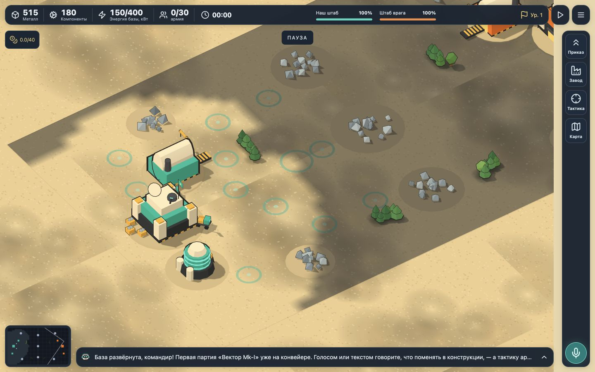
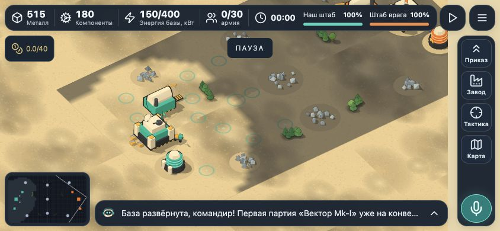
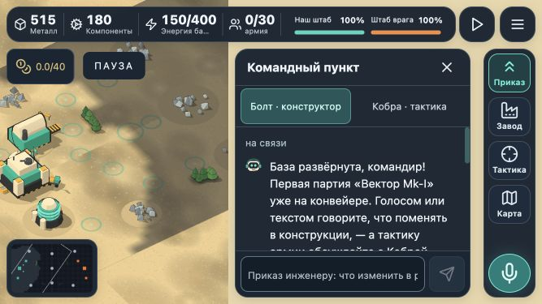

# Command rail layout — implementation and QA

Date: 28 October 2026. Branch: `codex/command-rail-mobile-layout`.

Implements the second selected visual concept in the existing game. The battlefield, simulation, existing assets and game rules remain in use.

## Result

- Compact resource/HQ bar, right command rail, separate minimap and one-line agent reply.
- One workspace at a time for orders, production, tactics, map and AI spending. Closing it restores battlefield space.
- Input, proposal approval and close controls remain reachable on short screens. Agent drafts survive workspace changes.
- Shared rail reservation keeps panels, replies, notifications and camera viewport clear of the rail. Desktop gutter is 20px; compact landscape gutter is 16px. Narrow-screen replies may end earlier.
- One visible microphone control: on the rail normally, in the form when keyboard mode hides the rail.
- Opening the match menu pauses the current match; returning restores its previous pause state. Restart and exit are explicit confirmed actions.
- Existing Android Back, fullscreen, pinch controls, analytics, language selection and native build targets are preserved after integration with current main.

## Visual evidence

Screenshots below were captured after integration with current main (`35efe2f`). The match is paused to make layout comparisons stable.

### Desktop — 1440×900

### Mobile landscape — 844×390

### Small landscape — 667×375, orders open

[Match menu](docs/qa/command-rail-20261028/menu.png) · [Selected concept compared with the live implementation](docs/qa/command-rail-20261028/concept-comparison.png) · [Reduced-height text entry](docs/qa/command-rail-20261028/keyboard-height.png).

The concept comparison and reduced-height capture were made before integration with main. Concept and live simulation differ in counters, map content, camera and dialogue; comparison concerns layout, not simulated scene equality. Deliberate adaptations include pause/menu controls and AI budget visibility, plus a smaller minimap and shorter reply on the narrowest screens.

## Checks and fixes

| Problem | Implemented behavior | Verification |
|---|---|---|
| Multiple competing control panels | One shared workspace, opened from the rail | Switched among orders, factory, tactics, map and budget |
| Menu reset the match | Pause and resume without replacing state | Five menu regression tests; browser open/return, focus return and prior pause |
| Agent draft lost on panel switches | Mounted console retains per-agent draft | Orders → factory → orders retained the entered draft |
| Approval/cancel controls too narrow or buried | Pinned footer; at least 44px frequent controls | Proposal inspected and approved at 667×375 |
| Factory and budget overflow on short/narrow screens | Scrollable inspector body; responsive table columns | No horizontal overflow in sampled production/tactics/map states; budget columns fit at 667×375 |
| Notices covered inspector | Latest notice is constrained to free field region | Harvester queue notification checked with factory open |
| Short settings dialog buried Save | Scrollable content and pinned footer | Short viewport inspection |
| Lower-right controls crowded | Shared gutter and single microphone | Final 14-state geometry and hit-target matrix |
| Input could disappear with limited height | VisualViewport/focus input mode and pinned form | Reduced-height 844×240 simulation: input/actions bottom 229px, 44px high |

The later user screenshot included the Codex host activity bar over the page. That host overlay is outside the game DOM. No game CSS change is claimed to control it.

## Browser coverage

Final post-integration pass checked watch and orders-open states at each size below. All 14 states had no sampled pinned control outside the viewport, one visible microphone, correct center hit targets, and the required minimum workspace/reply-to-rail gutter. Raw measurements: [final-geometry.json](docs/qa/command-rail-20261028/final-geometry.json).

| CSS viewport | State checks | Minimum required rail gutter |
|---|---|---:|
| 667×375 | Watch / orders | 16px |
| 740×360 | Watch / orders | 16px |
| 844×390 | Watch / orders | 16px |
| 932×430 | Watch / orders | 16px |
| 1191×641 | Watch / orders | 20px |
| 1280×720 | Watch / orders | 20px |
| 1440×900 | Watch / orders | 20px |

Earlier detailed browser QA also covered 1024×768, 1191×640/642 and 1280×690; all workspace types; production stop/resume and harvester queue; tactics selection; menu restart cancellation and exit; settings; spectator mode; RU/EN/IT switching; and one successful cloud constructor request followed by proposal approval. These are sampled scenarios, not a full gameplay or service reliability test.

Earlier measurements estimate 70–72% clear battlefield area in watch mode on the sampled phone sizes, 81% at 1024×768/1280×720 and 85% at 1440×900. Method: subtract the union of principal HUD rectangles from viewport area; excludes pause badges and transient notices. This is a geometric estimate, not rendered-pixel or performance measurement. Open inspectors temporarily reduce the clear field to approximately 41–51% on phones and 58–66% on larger screens. [Viewport data](docs/qa/command-rail-20261028/viewport-matrix.json) and [workspace overflow data](docs/qa/command-rail-20261028/surface-matrix.json).

## Automated validation after integration

- `npm run build` — passed.
- `npm run build:ios` — passed (web bundle for the iOS wrapper).
- `npm run build:android` — passed (web bundle for the Android wrapper).
- `npm test` — **251 passed, 5 skipped**; 23 test files passed, 2 skipped. Skips are existing opt-in live tests.
- Five added menu tests cover state/queue/proposal/chat/economy/budget/time preservation, repeated opening, manual pause, explicit restart, explicit exit/new mode and pre-start guarding.
- Analytics regression verifies opening/closing the menu emits no match-ending telemetry; explicit exit still does.
- Director and translated UI checks reflect the menu behavior and new menu component.
- `git diff --check` — passed.

## Limits and follow-up

Browser viewport simulation does not establish behavior on physical phones. Real native keyboards, notches/browser chrome, Android hardware Back, microphone/ASR, TTS, VoiceOver/TalkBack, a complete contrast audit, FPS, later levels and full victory flows were not tested here. Native builds above are web bundle builds, not device/APK/Xcode tests. No full WCAG compliance claim is made.

Verify compact labels, minimap size and text-entry behavior during an actual phone play session. Cancellation of an in-flight LLM request was outside this change; rejecting an already proposed design remains available.
